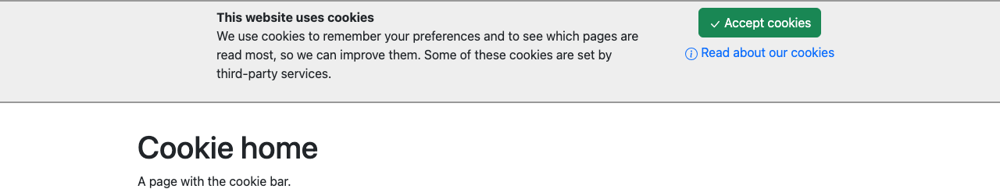

# Cookie bar for Silverstripe

A cookie notice your editors set up in the CMS: a bar at the top of every page with your own
title, text and optional image, an *Accept* button and a link to your cookie page, shown until the
visitor accepts. It can also run your own scripts, such as Google Consent Mode defaults, on every
page load and once consent is given, and it works without JavaScript too. For Silverstripe 5 and 6.



*Maintained by [Restruct](https://github.com/restruct). If this module saves you time, you can
[support ongoing maintenance](https://github.com/sponsors/restruct).*

Based on the cookiebar module by Aram Balakjian & Steve Heyes.

## A cookie notice is more than a line of text

Silverstripe has no cookie notice of its own. Building one per site means a template, a consent
cookie that the bar checks on every request, a place where editors can change the wording without a
developer, a fallback for visitors without JavaScript, and a way to keep tracking scripts from running
before the visitor has agreed, or on a development copy of the site.

This module does all of that with one template variable, `$CookieBar`, and a *Cookie bar* tab in
the site settings. It is a notice with a single *Accept* button: there are no per-category choices
(analytics, marketing) and no *Reject* button.

## Set up in the CMS, shown until the visitor accepts

### The Cookie bar tab in Settings

The bar is switched on and edited per site in the CMS, under *Settings > Cookie bar*.


| Field | Purpose |
|-------|---------|
| Enable Cookie Bar | Master switch. Off by default. |
| Cookie Bar Title | Heading in the bar. |
| Accept/Close Link Text | Text on the accept button. Default `Accept`. |
| More Information Link Text | Text on the link to the information page. Default `Read more about Cookies`. |
| Cookie Information Page | Page the information link points at; the link is hidden when empty. |
| Cookie bar Content | Body text, HTML. A default text is provided. Shown on every screen size: the module does not hide it on mobile (a theme can). |
| Image (optional) | jpg, jpeg, gif or png. Shown at most 80px high: a taller image is scaled down, a smaller one keeps its size. It is published when the settings are saved. |
| Optional RAW JS code to run on page initialisation | See [Scripts before and after consent](#scripts-before-and-after-consent). |
| Optional RAW JS code to run if/after consent | See [Scripts before and after consent](#scripts-before-and-after-consent). |
| Also insert scripts in dev/test environments | See *What a visitor sees* below. |

### What a visitor sees

* While the bar is enabled and the visitor has not consented, every page built on
  `ContentController` loads the bar's CSS and `CookieBar.js`. The script shows the bar at the top of
  the page from the `$CookieBar` markup and, on *Accept*, writes the consent cookie itself and fades
  the bar out.
* Visitors without JavaScript get the bar from a `<noscript>` copy in the same `$CookieBar` markup
  (message and links only, shown under the same conditions as the JS bar, where the template places
  `$CookieBar`) and follow its *Accept* link instead, to `/cookiebar/accept` (below the site's base
  URL), which sets the same cookie server side and redirects back (an AJAX request gets the plain
  response `success`).
* Once consent has been given, the bar's CSS and JS are no longer loaded at all; only the optional
  *run if/after consent* script is output, and called, on every page.
* Nothing is injected on the `Security` controller (login, logout, lost password).
* **In `dev` and `test` environments nothing is injected** unless *Also insert scripts in dev/test
  environments* is ticked, so tracking scripts do not run on development copies by accident.

### Scripts before and after consent

Two optional fields hold JavaScript that the module outputs for you. Both have HTML tags stripped,
and neither is output in `dev` and `test` environments (unless *Also insert scripts in dev/test
environments* is ticked) or on the `Security` controller (login, logout, lost password). Their
placeholders in the CMS show a Google Consent Mode example.

* **On page initialisation:** output in `$MetaTags`, before other scripts, whether or not the
  visitor has consented and whether or not the bar is enabled. Use it for defaults such as
  `gtag('consent', 'default', {...})`.
* **If/after consent:** wrapped in a function `cookieBarRunIfConsent()`. Before consent,
  `CookieBar.js` calls it when the visitor accepts; once consent exists, every page outputs the
  function and calls it itself (once the DOM is ready). Use it for `gtag('consent', 'update', {...})`
  or to load scripts that need consent.

The on-init script is added through `$MetaTags`. If your templates do not call `$MetaTags()`, place
`$SiteConfig.CookieBarRunOnInitScript` in the `<head>` yourself. It applies the same checks as the
`$MetaTags` path: nothing in `dev` and `test` unless *Also insert scripts in dev/test environments*
is ticked, and nothing on the `Security` controller.

## Requirements

* Silverstripe CMS 5 or 6 (`silverstripe/cms`, `silverstripe/siteconfig`, `silverstripe/asset-admin`)
* PHP 8.1 or newer (Silverstripe 6 itself needs 8.3)
* A project `PageController` class: `CookieBarController` (the `cookiebar/accept` action) extends
  the project's own `PageController`, which every standard CMS project has
* On Silverstripe 6, the *Cookie bar Content* field is a WYSIWYG editor only when the project has
  `silverstripe/htmleditor-tinymce` installed (TinyMCE is a separate module there); without it the
  field is a plain textarea that takes HTML

## Version compatibility

| Branch | Module version | Silverstripe | PHP |
|--------|----------------|--------------|-----|
| `main` | `2.3.1` - `2.3.3` and `3.1.0` - `3.1.2` (tagged in pairs, same code) | `^5 \|\| ^6` | `^8.1` |
| (tags only) | `2.3.0` | `^5 \|\| ^6` | not declared; broken on Silverstripe 6, upgrade to the latest pair |
| (tags only) | `3.0.0`, `3.0.1` | `^6` | not declared (Silverstripe 6: 8.3+); superseded by `3.1.x` |
| (tags only) | `2.2.3`, `2.2.4` | `^4 \|\| ^5` | not declared (follows Silverstripe) |
| (tags only) | `2.0` - `2.2.2` | `^4.4` | not declared (follows Silverstripe) |

Silverstripe 4 reached end of life in April 2025 and is no longer supported or tested here. Projects
still on it should stay on the `2.2.x` tags, which remain available.

`main` is the only maintained line and supports Silverstripe 5 and 6 from one codebase. Each release
is tagged twice with identical code: `2.3.x` for projects constrained to `^2`, and `3.1.x` so that
Silverstripe 6 projects on `^3` receive the same fixes (currently `2.3.3` and `3.1.2`). The older
`3.0.0` and `3.0.1` tags (Silverstripe 6 only) predate this line and are superseded by `3.1.x`; see
[CHANGELOG.md](CHANGELOG.md).

**`composer.json` is the source of truth** for exact constraints; this table is a quick reference.

## Installation

Install via `composer require restruct/silverstripe-cookiebar` and add `$CookieBar` just before the
closing body tag:

```
...
    $CookieBar
</body>
```

`CookieBar.js` moves the bar to the top of `<body>` when it shows it; the `<noscript>` copy for
visitors without JavaScript stays where `$CookieBar` is placed.

The included template uses Bootstrap classes for its layout. In case the site theme does not use
Bootstrap, a 'sans-bs' CSS file can be added which provides a fallback layout (see
[Configuration](#configuration)).

The module applies its extensions itself (to `SiteTree`, `ContentController` and `SiteConfig`); run
`dev/build` (Silverstripe 5) or `sake db:build` (Silverstripe 6) after installing to add its
`SiteConfig` fields.

## Configuration

Config options (with their defaults):
```yml
Restruct\CookieBar\Controls\CookieBarController:
  sans_bs_css: false # include no-bootstrap version CSS
  cookie_name: 'cookie_consent' # name of cookie with timestamp of consent
  cookie_age: 365 # cookie expiration in days
  cookie_refresh: true # refresh consent cookie upon each request
```

`sans_bs_css: true` adds `cookiebar-layout-sans-bs.css` (columns and buttons, what Bootstrap would
otherwise provide) on top of `cookiebar.css`, which always loads and holds the bar's own styling:
background, borders, bold title and image offset. Before 2.4.0 / 3.2.0 the layout file replaced
`cookiebar.css` and the bar lost that styling
([#9](https://github.com/restruct/silverstripe-cookiebar/issues/9)).

A cookie named `Restruct_CookiesAccepted`, set by older versions of this module, is still accepted as
consent.

Prefab CSS inclusion can be blocked altogether from `_config.php`:
```php
Requirements::block('restruct/silverstripe-cookiebar:client/dist/css/cookiebar.css');
```

To change the markup, override the template `Restruct/CookieBar/CookieBar.ss` in your theme.

## Public API

For templates, on any `ContentController`:

* `$CookieBar` - the bar markup (a `text/x-template` script block, plus a `<noscript>` copy of the bar
  for visitors without JavaScript), or nothing when the bar is disabled.
* `$CookieConsent` - whether the visitor has consented. Also available as `$SiteConfig.CookieConsent`.
* `$AcceptCookiesLink` - the accept URL, document-relative (`cookiebar/accept`), as used in the JS template.
* `$AcceptCookiesRootLink` - the accept URL relative to the web root (`/cookiebar/accept`, including any
  base URL subdirectory); use this one in your own markup, since the document-relative form 404s on
  pages below the site root.
* `$ShowNoScriptCookieBar` - whether the `<noscript>` bar is output: scripts allowed for this request
  (not `Security`, not dev/test unless enabled) and no consent yet.

From PHP, static methods on `Restruct\CookieBar\Controls\CookieBarController`:

* `isCookieAccepted(): bool` - whether consent exists (refreshes the cookie when `cookie_refresh` is on).
* `getCookieName()` / `setCookieName(string)` and `getCookieAge()` / `setCookieAge(int)` - read or
  override `cookie_name` and `cookie_age` at runtime.
* `find_link($action)` - the controller URL for an action, eg `find_link('accept')`.

And `Restruct\CookieBar\Extensions\ContentControllerExtension::cookieBarEnabled(): bool` for the
current site's master switch.

## Running the tests

The module cannot be tested on its own: it needs a host Silverstripe project (built from
`silverstripe/recipe-cms` plus `silverstripe/recipe-testing`). Require it there through a Composer
**path repository with `symlink: true`** - `/tests` is `export-ignore`, so a dist or mirrored install
contains no tests - add the `Restruct\CookieBar\Tests\` namespace to the host's `autoload-dev`
(pointing at `vendor/restruct/silverstripe-cookiebar/tests/`), then:

```bash
# Silverstripe 5 (PHPUnit 9) - the path must come before flush=1
vendor/bin/phpunit vendor/restruct/silverstripe-cookiebar/tests flush=1

# Silverstripe 6 (PHPUnit 11) - a flush=1 argument is ignored, use the env var
SS_PHPUNIT_FLUSH=1 vendor/bin/phpunit vendor/restruct/silverstripe-cookiebar/tests
```

CI runs the same suite against Silverstripe 5 and 6 on every push; see `.github/workflows/ci.yml`.
Playwright browser tests (the bar, *Accept* with and without JavaScript, the scripts and the CMS
settings) live in `tests/browser/` and run in `.github/workflows/browser-tests.yml`. The screenshots
in this README are generated, not drawn: see
[tests/browser/screenshots/README.md](tests/browser/screenshots/README.md).

## Changelog and license

See [CHANGELOG.md](CHANGELOG.md) for what changed in each release, and [LICENSE](LICENSE) (MIT).
